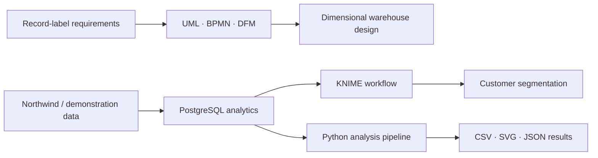
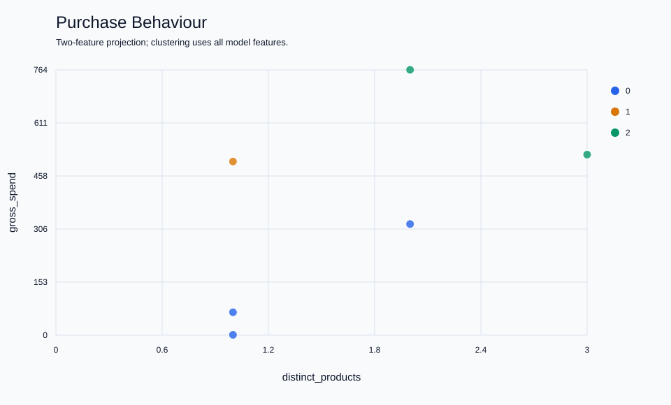

# Information Systems · Data Warehouse & Analytics

University project developed for the **Information Systems Laboratory** course at the **University of Turin**, academic year **2024/2025**, by **Federico Santorsola and Davide Vercelli**.

The project combines the design of a data warehouse for a record label with sales analytics and customer segmentation on the Northwind domain. It includes UML and BPMN modelling, dimensional design, PostgreSQL analytical queries, a KNIME workflow and a reproducible command-line analysis pipeline.



## Project overview

| Area | Content |
| --- | --- |
| Data warehouse design | Record-label domain, purchase process, fact grain, dimensions and analytical requirements. |
| Sales analytics | Top five products by gross revenue, using the price recorded on each order line. |
| Time-series analysis | Three-quarter moving averages per product and per product/country, including zero-sales quarters. |
| Data mining | Two customer-segmentation models using normalized purchase and discount features. |
| Reproducibility | Synthetic demonstration data, deterministic clustering, exports and automated checks. |

The record-label warehouse is a design exercise. The executable analyses use Northwind's customers, orders, order details and products.

## Repository structure

```text
.
├── knime/
│   ├── PROGETTO.knwf              Importable KNIME workflow
│   └── PROGETTO/                  Workflow source and node settings
├── sql/
│   ├── 01_top_products.sql
│   ├── 02_rolling_by_product.sql
│   ├── 03_rolling_by_product_country.sql
│   ├── 04_customer_features.sql
│   └── demo_data.sql              Synthetic data for an empty demo database
├── scripts/
│   ├── analyze.py                SQL execution, clustering and exports
│   ├── check_sql.py              PostgreSQL integration checks
│   ├── package_workflow.py       Rebuild the KNIME archive
│   ├── sync_workflow_sql.py      Synchronize embedded SQL with sql/
│   └── validate_project.py       Check workflow integrity and packaging
├── tests/                        Clustering and export tests
├── docs/
│   ├── project-report.pdf        Course report, in Italian
│   ├── project-design.md         Domain and analytical design
│   ├── setup.md                  Database and KNIME instructions
│   ├── assets/                   Design diagrams from the report
│   └── demo-results/             Checked-in synthetic example results
├── .github/workflows/checks.yml
├── Makefile
└── README.md
```

## Quick start

Requirements: **PostgreSQL 14 or newer**, its `psql` and `createdb` tools, and **Python 3.10 or newer**. The Python pipeline uses only the standard library. KNIME is needed only for the visual workflow.

From the repository root, create an empty database and load the demonstration data:

```bash
createdb si_demo
psql -X --set=ON_ERROR_STOP=1 --single-transaction --dbname=si_demo --file=sql/demo_data.sql
python3 scripts/analyze.py --database si_demo
```

The connection follows PostgreSQL's standard `PGHOST`, `PGPORT`, `PGUSER` and password-file settings. See [setup](docs/setup.md) for authentication and platform notes.

Results are written to `results/`:

- four CSV files for the SQL analyses and customer features;
- two customer/cluster assignment CSV files;
- two SVG scatter plots with customer tooltips;
- `summary.json` with feature ranges, cluster sizes, centroids and within-cluster squared distances.

For an existing Northwind database:

```bash
python3 scripts/analyze.py --database NW2 --output-dir results/northwind
```

The expected table and column names are documented in [setup](docs/setup.md#northwind-schema). The original course database backup is not included. Demonstration records are explicitly synthetic and do not reproduce Northwind's numerical results.

## Sales and quarterly analysis

Gross revenue is `SUM(order_line.UnitPrice × Quantity)`. Using the order-line price preserves historical price changes. The catalogue price in `Products` is not used, and discounts are excluded from this specific metric. This is revenue, not accounting profit.

The moving-average queries first aggregate quantities by calendar quarter, insert zero-sales quarters between each series' first and last observations, and average the current quarter with the previous two. Each product, or product/country pair, has an independent window. The first two quarters use the available one or two observations. Country refers to `Orders.ShipCountry`.

Run individual queries with:

```bash
psql -X --set=ON_ERROR_STOP=1 --dbname=si_demo --file=sql/01_top_products.sql
psql -X --set=ON_ERROR_STOP=1 --dbname=si_demo --file=sql/02_rolling_by_product.sql
psql -X --set=ON_ERROR_STOP=1 --dbname=si_demo --file=sql/03_rolling_by_product_country.sql
```

## Customer segmentation

Both models use **k-means with three clusters** after min-max normalization to `[0, 1]`.

| Model | Features |
| --- | --- |
| Purchase behaviour | Distinct order count, distinct product count, gross spending. |
| Discount behaviour | Distinct order count, total quantity, net spending after discounts, mean order-line discount. |

The Python implementation uses seed `0`, ten initializations and at most 99 iterations per initialization. It keeps the solution with the lowest within-cluster sum of squared distances. Constant features become zero. Customers without purchases are excluded.



The figure is a two-feature projection of the purchase-behaviour model on the six synthetic purchasing customers. Cluster IDs are numerical labels; business interpretations require inspecting the centroids and underlying data. Different initializations or implementations can produce different assignments, so KNIME and Python cluster IDs are not compared directly.

See [example results](docs/demo-results/README.md) for both models and the quarterly calculation.

## KNIME workflow

Import [`knime/PROGETTO.knwf`](knime/PROGETTO.knwf) into **KNIME Analytics Platform**. The workflow is based on the 5.4 node family and contains **29 nodes in four analysis branches**:

1. top products by gross revenue;
2. quarterly moving averages, with and without country;
3. customer segmentation by purchase behaviour;
4. customer segmentation by quantity, spending and discounts.

Configure the four PostgreSQL Connector nodes with your local database credentials. No usernames or passwords are stored in the distributed workflow. Analytical SQL is executed in PostgreSQL; KNIME reads the results, normalizes the customer features, fits k-means and provides scatter-plot views. The time-series outputs are also connected to Data to Report (BIRT) nodes.

See [KNIME setup](docs/setup.md#knime) for the required node extensions and execution steps. The CLI can be used independently of KNIME.

## Verification

```bash
python3 -m unittest discover -s tests -v
python3 scripts/validate_project.py
python3 scripts/check_sql.py --database postgres
```

The SQL check creates temporary tables inside a transaction and rolls them back. It checks historical prices, duplicate product names, missing quarters, year boundaries, independent product/country windows, distinct orders and discounts. It requires access to a PostgreSQL database with permission to create temporary tables.

GitHub Actions runs these checks against PostgreSQL 17 and executes the complete demonstration pipeline. Workflow validation checks XML, graph integrity, credentials, synchronization with the SQL files and archive contents. Interactive KNIME execution requires a local KNIME installation and database connection.

After editing the SQL or workflow source, synchronize the embedded queries and rebuild the archive with:

```bash
python3 scripts/package_workflow.py
```

## Documentation and academic context

The [course report](docs/project-report.pdf) describes the assignment, record-label model, warehouse design, Northwind analyses and customer clustering. The [design notes](docs/project-design.md) explain the analytical definitions and modelling choices used by the project.

The work was developed by **Federico Santorsola and Davide Vercelli** for the Information Systems Laboratory at the University of Turin, academic year 2024/2025.

No project-wide open-source license has been selected.
