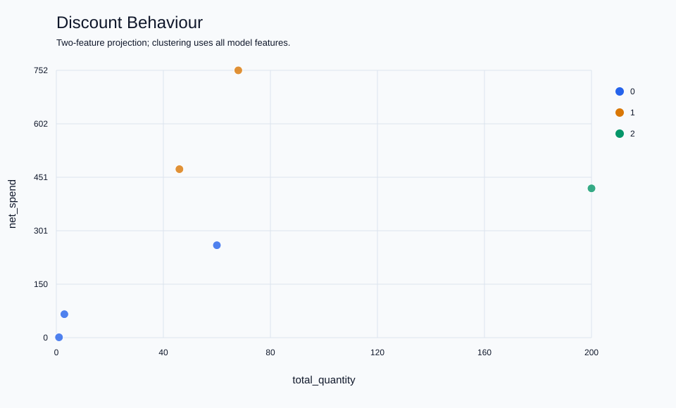

# Demonstration results

These files are generated from [`sql/demo_data.sql`](../../sql/demo_data.sql). All customers and transactions are synthetic. The fixture has six purchasing customers and one customer with no purchases; it is intentionally small enough to inspect by hand.

## Product revenue

| Product ID | Name | Gross revenue |
| --- | --- | ---: |
| 1 | Demo Tea | 1200 |
| 5 | Demo Juice | 520 |
| 3 | Demo Coffee | 320 |
| 2 | Demo Tea | 106 |
| 4 | Demo Cocoa | 24 |

Products 1 and 2 share a display name but remain separate products. Revenue uses historical order-line prices even though the catalogue has different prices.

## Quarterly moving average

For product 1, the aggregated quantities are:

| Quarter | Quantity | Three-quarter moving average |
| --- | ---: | ---: |
| 2024 Q1 | 10 | 10.00 |
| 2024 Q2 | 20 | 15.00 |
| 2024 Q3 | 30 | 20.00 |
| 2024 Q4 | 0 | 16.67 |
| 2025 Q1 | 40 | 23.33 |

The zero-sales quarter contributes to the window. The country query builds independent calendars for Italy and France.

## Customer segmentation

Purchase behaviour uses order count, product variety and gross spending:


Discount behaviour uses order count, total quantity, net spending and mean discount:



The models produce cluster sizes `[3, 1, 2]` and `[3, 2, 1]`, respectively. These are demonstrations of the pipeline, not validated customer personas. See [summary.json](summary.json) for centroids and scaling parameters, and the CSV files for individual assignments.

Regenerate the outputs using a dedicated demonstration database:

```bash
python3 scripts/analyze.py --database si_demo --output-dir docs/demo-results
```

Run this command from the repository root and use the supplied synthetic fixture. Outputs from a different database will describe that database instead.
