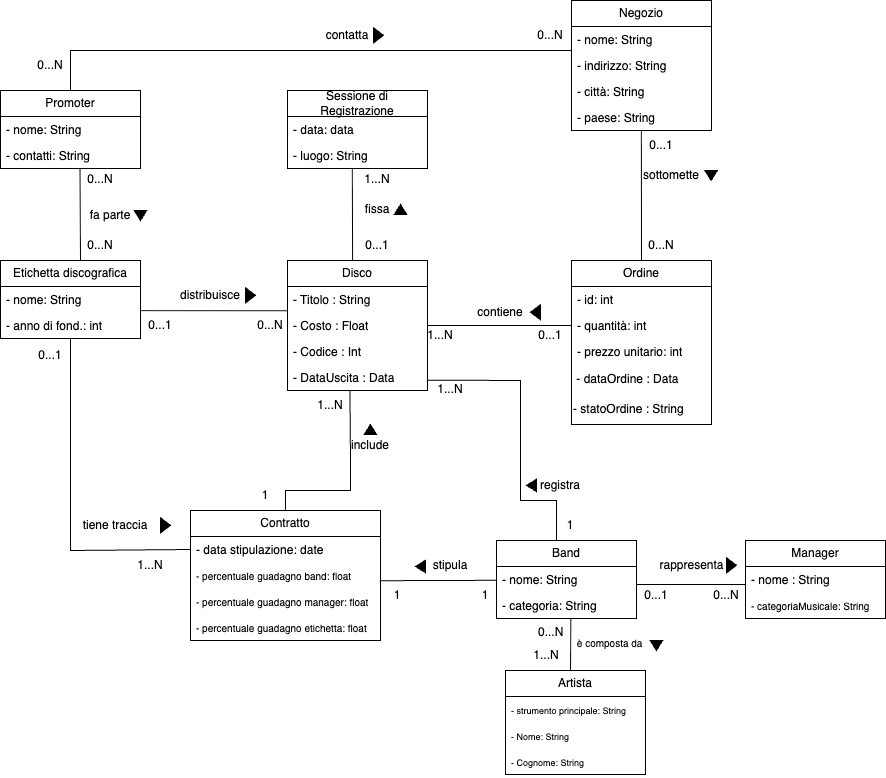
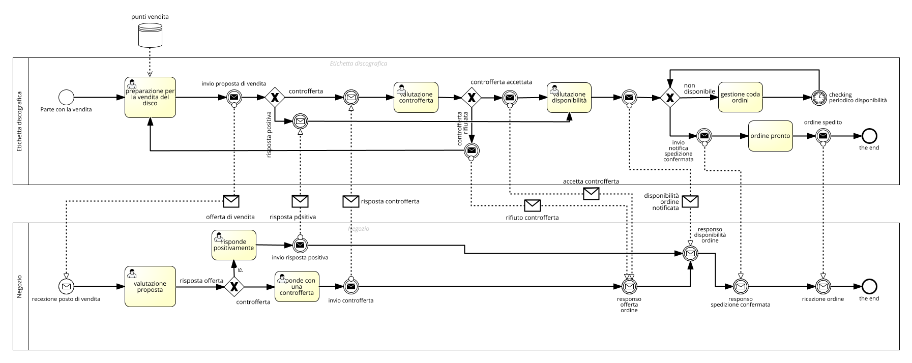
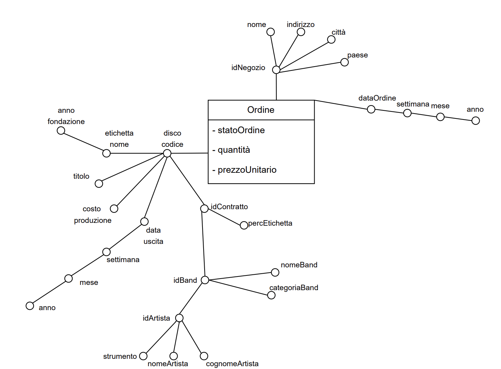
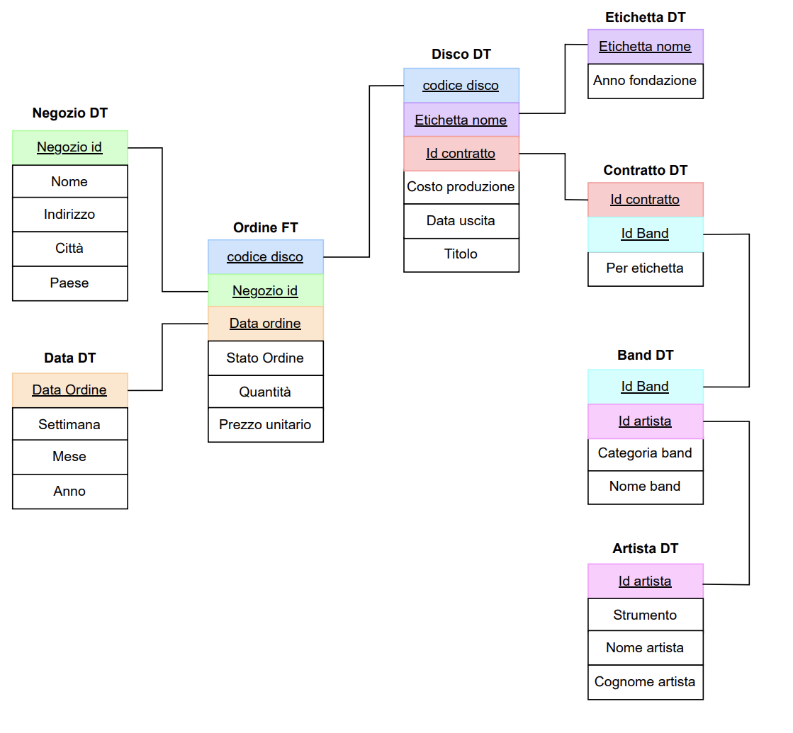

# Project design

## Academic scope

The project addresses three exercises in the Information Systems Laboratory: design a record-label data warehouse, analyze Northwind sales, and apply a data-mining algorithm to Northwind customers. The [course report](project-report.pdf) contains the assignment and the accompanying diagrams and discussion in Italian.

The record-label and Northwind domains serve separate purposes. The former is the modelling case study; the latter supplies the executable sales and customer analysis.

## Record-label domain

The domain includes record labels, records, contracts, bands, artists, managers, recording sessions, promoters, stores and orders. Stores request records from a label, while contracts connect commercial rights and revenue shares to the label, band and record.



The purchase process models both the store and record label, including the request, availability checks and the subsequent order handling.



These diagrams are extracted from the course report. Editable UML/BPMN project files were not included with the supplied materials.

## Dimensional analysis

The central analytical event is an order for a record by a store. Its grain must identify a particular order line, including the record, destination store and order date. Distinct orders for the same record, store and date must remain distinguishable; those three dimension keys alone are not a sufficient fact identifier.

| Analytical component | Content |
| --- | --- |
| Fact | Order line, its requested quantity, unit selling price and fulfilment status. |
| Product | Record code, title, release date and production-cost information. |
| Commercial context | Label, contract, applicable label share and band. |
| Geography | Store → city → country. |
| Time | Calendar date, month, year and an explicit week convention. |
| Artists | Band membership and artist identity. |

The DFM development organizes these attributes around the order fact and removes attributes that do not contribute to the required analyses.



The report's dimensional drawing separates related dimensions, including record → contract → band → artist and record → label. This is a snowflake-style organization around the order fact.



The analytical questions are:

- Which records, bands or artists produce the highest or lowest earnings and investment return by week, month or year?
- Which stores, cities or countries have the most unfulfilled requests?
- Which records, bands or artists receive the most requests?

Request counts and requested quantities are different measures: `COUNT(order lines)` measures requests, while `SUM(quantity)` measures units. Fulfilment status is a categorical attribute used to filter or classify facts. Unit price should not be summed directly; revenue is derived from quantity and the applicable selling price.

Earnings and ROI additionally require explicit accounting rules: which order statuses recognize revenue, how contract shares apply over time, what costs belong to the investment and how record-production costs are allocated without repeating the full cost on every order. The model captures the relevant business concepts; no financial result is claimed without those inputs.

Artist analysis must also account for bands with multiple members. A physical warehouse would use a membership bridge and either distinct fact counting or an explicit allocation rule to avoid multiplying revenue across artists. Contract changes require an effective-date policy. These decisions matter when translating the conceptual model into a physical warehouse.

## Northwind analytical layer

The executable analytical layer uses four read-only SQL queries. PostgreSQL performs joins, aggregation and window operations. KNIME and the Python CLI consume the same feature definitions.

### Product revenue

For every order detail:

```text
line gross revenue = historical unit price × quantity
product gross revenue = sum of line gross revenue for that product
```

Grouping uses both product ID and product name so that equally named products remain separate. The top-five ranking uses product ID as a deterministic tie-breaker. Neither discount nor production cost is part of this exercise's revenue measure.

### Moving quarterly average

Quarter is the first calendar day of the corresponding three-month period. Quantities are summed before applying a window. Every internal missing quarter is materialized with a zero total, and each series runs from its own first to last observed quarter.

```text
MA(t) = average of quantity(t), quantity(t-1), quantity(t-2)
```

At the beginning of a series, only available calendar quarters contribute to the denominator. No values are invented before a series' first observed quarter or after its last one.

The country variant partitions by both product and shipping country. Orders with missing dates cannot be assigned to a quarter and are excluded from quarterly analysis; the country variant also excludes unknown shipping countries. Revenue and customer features still include valid order lines associated with those orders.

### Customer features

| Feature | Definition |
| --- | --- |
| `order_count` | `COUNT(DISTINCT OrderID)` per customer. |
| `distinct_products` | Number of distinct purchased product IDs. |
| `gross_spend` | Sum of historical unit price × quantity. |
| `net_spend` | Sum of historical unit price × quantity × (1 − discount). |
| `total_quantity` | Sum of purchased units. |
| `mean_discount` | Arithmetic mean of order-line discount fractions. |

A missing discount is interpreted as zero. Mean discount is line-weighted, not weighted by quantity or spending. Customers without purchases are excluded from clustering. Features aggregate all available purchase history; this is not a recency-based RFM model.

## Customer segmentation

K-means groups customers by Euclidean distance in a normalized feature space. Purchase behaviour uses order frequency, product variety and gross spending. Discount behaviour uses order frequency, quantities, net spending and mean discounts.

For feature `x`, min-max scaling is `(x − min(x)) / (max(x) − min(x))`; a constant feature is mapped to zero. The CLI uses three clusters, seed zero, ten random initializations and up to 99 Lloyd iterations per initialization. It selects the lowest-inertia result and sorts its centroid vectors to assign stable display IDs.

The algorithm reports cluster sizes, normalized centroids, centroids in original units, feature ranges and inertia. Empty clusters, if encountered, retain their previous centroid and are reported with size zero. At least three distinct feature vectors are required. A fixed seed makes repeated runs of the CLI reproducible for the same ordered data; it does not guarantee identical labels across different software implementations.

The plots project each model onto two raw features. They are useful for inspecting assignments but do not show the entire three- or four-dimensional distance calculation. Cluster IDs have no inherent business meaning, and the project does not claim that three clusters are universally optimal. Outliers remain visible in the analysis.

## Validation boundaries

The automated checks exercise analytical semantics, deterministic clustering, numerical edge cases, export generation and workflow packaging. The synthetic fixture is designed to expose price-history errors, product-name collisions, missing calendar periods, cross-series contamination and overcounted orders.

KNIME's interactive views, extension installation and JDBC configuration must be checked in a local KNIME environment. Static workflow validation verifies the graph, XML settings and embedded SQL, rather than claiming that a desktop KNIME session has executed.
